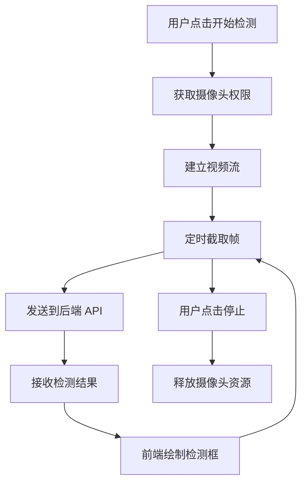
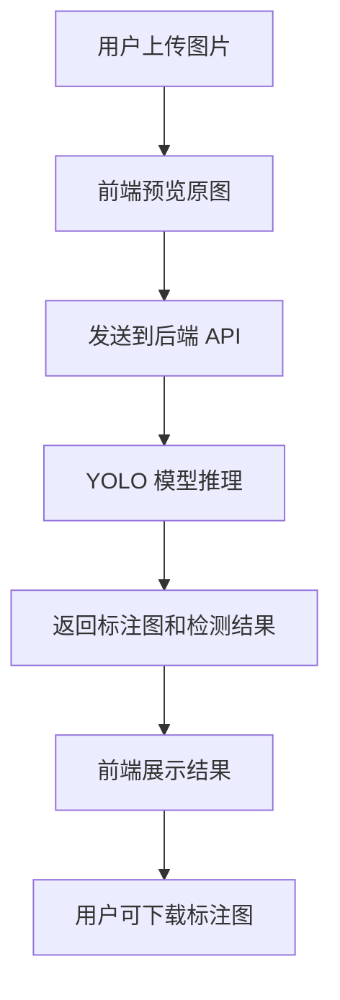

# 垃圾分类智能检测系统 - 产品需求文档

## 1. 产品概述

基于 YOLOv5 的垃圾分类实时检测网页应用，用户可通过摄像头实时识别或上传图片进行垃圾分类检测。

- **核心目的**：提供直观的垃圾分类检测界面，支持实时摄像头检测和图片上传检测
- **目标用户**：垃圾分类检测需求的用户
- **产品价值**：将训练好的 YOLOv5 模型快速部署为可交互的 Web 应用

## 2. 核心功能

### 2.1 功能模块

1. **摄像头实时检测**
   - 实时获取摄像头画面
   - 逐帧调用后端 API 进行检测
   - 在画面上实时绘制检测框和标签
   - 支持开始/停止检测控制

2. **图片上传检测**
   - 支持拖拽上传和点击上传
   - 支持 JPG/PNG 格式
   - 上传后自动检测并展示结果
   - 显示原图和标注图对比

3. **结果展示与下载**
   - 展示检测到的垃圾类别和置信度
   - 支持下载标注后的图片
   - 统计各分类数量

4. **参数控制面板**
   - 模型选择：yolov5s / yolov5m / yolov5n
   - 置信度阈值调节：0.1 - 1.0
   - IoU 阈值调节：0.1 - 1.0

### 2.2 页面详情

| 页面 | 模块名称 | 功能描述 |
|------|----------|----------|
| 主页面 | 模式切换 | 顶部 Tab 切换「摄像头」和「图片上传」两种模式 |
| 主页面 | 检测预览区 | 中央显示摄像头画面或上传图片预览，带检测框渲染 |
| 主页面 | 参数控制面板 | 右侧或底部收起面板，包含模型选择、置信度滑块、IoU 滑块 |
| 主页面 | 结果展示区 | 检测到的类别列表、置信度、统计数据 |
| 主页面 | 操作按钮 | 开始检测、截图保存、下载标注图 |

## 3. 核心流程

### 3.1 摄像头检测流程

### 3.2 图片上传检测流程

## 4. 用户界面设计

### 4.1 设计风格

**极简苹果风格 (Apple Design)**

- **主色调**：`#ffffff` 纯白背景 + `#1d1d1f` 深黑文字
- **强调色**：`#0071e3` Apple Blue，用于主要按钮和交互元素
- **圆角**：统一使用 `12px` 圆角（卡片）、`8px` 圆角（按钮）
- **阴影**：使用极淡的 `box-shadow: 0 2px 12px rgba(0,0,0,0.08)`，营造轻盈层次感
- **字体**：SF Pro Display（系统字体 fallback: -apple-system, BlinkMacSystemFont）
- **图标**：使用 SF Symbols 风格的线性图标
- **布局**：大量留白，内容居中，网格系统采用 12 列

### 4.2 页面设计概览

| 页面 | 模块名称 | UI 元素描述 |
|------|----------|-------------|
| 主页面 | 顶部导航栏 | 白色背景，高度 48px，左侧 Logo，右侧设置图标 |
| 主页面 | Tab 切换 | 两个标签「摄像头」「图片」，选中态有底部指示条滑入动画 |
| 主页面 | 预览区域 | 16:9 比例容器，圆角卡片，检测框彩色半透明覆盖 |
| 主页面 | 控制面板 | 收起式设计，点击展开，显示模型选择器和滑块 |
| 主页面 | 结果面板 | 类别标签列表，每个类别显示图标、名称、置信度进度条 |
| 主页面 | 操作按钮 | 主按钮 Apple Blue 填充，次按钮白底蓝边 |

### 4.3 动效设计

**性能优先原则**：所有动画使用 CSS transform 和 opacity，避免重排（reflow）。

| 动效场景 | 动画类型 | 时长 | 缓动函数 |
|----------|----------|------|----------|
| 页面加载 | 元素从下方淡入上移 | 400ms | ease-out |
| Tab 切换 | 指示条滑动 + 内容淡入淡出 | 250ms | ease-in-out |
| 控制面板展开 | 高度折叠动画 | 300ms | ease-out |
| 检测框出现 | 缩放 + 透明度 | 200ms | ease-out |
| 结果列表 | 依次滑入 | 100ms 间隔 | ease-out |
| 按钮悬停 | 背景色渐变 + 轻微上移 | 150ms | ease |
| 加载状态 | 骨架屏脉冲动画 | 1.5s 循环 | ease-in-out |

### 4.4 响应式设计

- **桌面优先**（主要使用场景）
- **平板适配**：控制面板移至底部抽屉
- **移动端适配**：单列布局，Tab 改为下拉选择

### 4.5 检测框配色方案

| 类别 | 颜色 | Hex |
|------|------|-----|
| cardboard | 橙黄 | `#f59e0b` |
| glass | 青色 | `#06b6d4` |
| metal | 银灰 | `#64748b` |
| paper | 蓝色 | `#3b82f6` |
| plastic | 红色 | `#ef4444` |

## 5. 非功能性需求

### 5.1 性能需求

- 摄像头检测帧率：≥ 10 FPS
- 单张图片检测响应时间：< 500ms
- 页面首次加载时间：< 2s

### 5.2 兼容性

- Chrome 90+
- Firefox 88+
- Safari 14+
- Edge 90+
