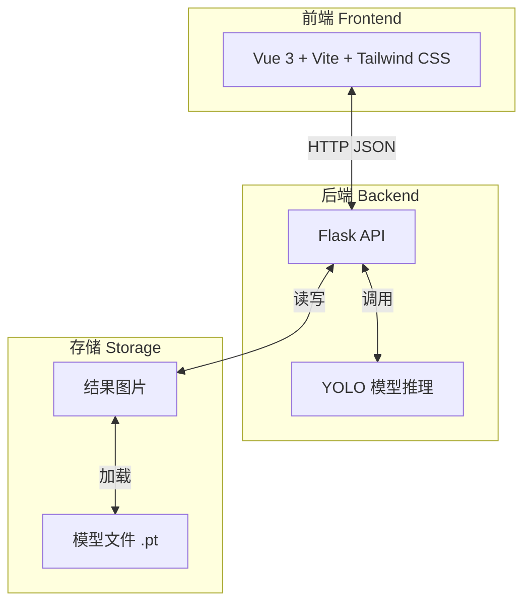

# 垃圾分类智能检测系统 - 技术架构文档

## 1. 架构设计



## 2. 技术选型

| 层级 | 技术 | 版本 |
|------|------|------|
| 前端框架 | Vue | 3.x |
| 构建工具 | Vite | 5.x |
| CSS 框架 | Tailwind CSS | 3.x |
| 后端框架 | Flask | 2.x |
| Python 版本 | Python | 3.10+ |
| YOLO 库 | Ultralytics | latest |
| 图像处理 | OpenCV / PIL | latest |

## 3. 路由定义

### 3.1 前端路由

| 路由 | 页面 | 说明 |
|------|------|------|
| `/` | HomeView | 主页面（摄像头/图片检测） |
| `/camera` | CameraView | 摄像头检测页 |
| `/upload` | UploadView | 图片上传检测页 |

### 3.2 后端 API

| 接口 | 方法 | 说明 |
|------|------|------|
| `/api/models` | GET | 获取可用模型列表 |
| `/api/detect` | POST | 图片检测（multipart/form-data） |
| `/api/detect_base64` | POST | 摄像头帧检测（JSON body） |
| `/api/download/<filename>` | GET | 下载标注图片 |
| `/api/health` | GET | 健康检查 |

## 4. API 详细定义

### 4.1 GET /api/models

**响应示例：**
```json
{
  "models": [
    { "id": "yolov5s", "name": "YOLOv5 Small", "size": "17.7 MB" },
    { "id": "yolov5m", "name": "YOLOv5 Medium", "size": "48.2 MB" },
    { "id": "yolov5n", "name": "YOLOv5 Nano", "size": "5.3 MB" }
  ],
  "current": "yolov5s"
}
```

### 4.2 POST /api/detect

**请求：**
- Content-Type: `multipart/form-data`
- 字段：`image` (文件), `model` (string, optional), `conf` (float, 0-1), `iou` (float, 0-1)

**响应：**
```json
{
  "success": true,
  "detections": [
    { "class": "glass", "confidence": 0.95, "bbox": [x1, y1, x2, y2] },
    { "class": "paper", "confidence": 0.87, "bbox": [x1, y1, x2, y2] }
  ],
  "annotated_image": "data:image/jpeg;base64,...",
  "counts": { "glass": 1, "paper": 1 }
}
```

### 4.3 POST /api/detect_base64

**请求：**
```json
{
  "image": "base64_encoded_image_data",
  "model": "yolov5s",
  "conf": 0.5,
  "iou": 0.45
}
```

**响应：**
```json
{
  "success": true,
  "detections": [...],
  "annotated_image": "data:image/jpeg;base64,...",
  "counts": {...}
}
```

## 5. 项目结构

```
YOLOv5/
├── backend/
│   ├── app.py              # Flask 主应用
│   ├── yolo_service.py     # YOLO 推理服务
│   └── uploads/            # 上传文件临时存储
│
├── frontend/
│   ├── public/
│   ├── src/
│   │   ├── assets/
│   │   ├── components/
│   │   │   ├── CameraView.vue
│   │   │   ├── ImageUpload.vue
│   │   │   ├── ControlPanel.vue
│   │   │   ├── ResultPanel.vue
│   │   │   └── DetectionCanvas.vue
│   │   ├── composables/
│   │   │   └── useDetection.ts
│   │   ├── App.vue
│   │   └── main.ts
│   ├── index.html
│   ├── package.json
│   ├── vite.config.ts
│   └── tailwind.config.js
│
└── runs/train/             # 训练好的模型权重
    └── exp1_yolov5s_bs16-2/weights/best.pt
```

## 6. 数据流设计

### 6.1 摄像头检测数据流

1. `getUserMedia` 获取视频流 → 绑定到 `<video>` 元素
2. `requestAnimationFrame` 定时器每 100ms 截取一帧
3. Canvas 转为 base64 → POST `/api/detect_base64`
4. 接收带检测框的 base64 图，绘制到预览 Canvas
5. 检测结果更新结果面板

### 6.2 图片上传检测数据流

1. 拖拽/点击上传 → FileReader 读取
2. 前端预览原图
3. FormData 上传 → POST `/api/detect`
4. 接收标注图 base64 和检测结果
5. 显示原图/标注图对比 + 结果列表
